# Autonomous UI Test Agent

An agent that takes a GitHub issue in the "Ready for QA" column, reads its
acceptance criteria, drives a real browser through the feature, and decides
whether it passed — without a single hardcoded selector or test script.

Built for the QA Automation Engineer take-home assignment.

```mermaid
%% Generated by https://gitdiagram.com/rayanfer32/autonomous-ui-test-agent
flowchart TD

subgraph group_intake["Issue intake"]
  node_issue_source["Issue source<br/>[issue_loader.py]"]
end

subgraph group_planning["Planning and models"]
  node_issue_data["Issue and criteria<br/>[models.py]"]
  node_settings["Run settings<br/>[config.py]"]
  node_planner["Scenario planner<br/>[planner.py]"]
  node_prompts["Agent prompts<br/>[prompts.py]"]
  node_llm["LLM client<br/>[llm.py]"]
end

subgraph group_execution["Browser execution"]
  node_agent["Execution loop<br/>[agent.py]"]
  node_browser["MCP browser tools<br/>[browser.py]"]
end

subgraph group_verification["Verification and reporting"]
  node_guardrails["Loop and quote checks<br/>[guardrails.py]"]
  node_recorder["Run recorder<br/>[evidence.py]"]
  node_evidence_store[("Run evidence files")]
  node_report["Report writer<br/>[report.py]"]
end

node_qa(("QA engineer"))
node_cli["Run CLI<br/>[run_agent.py]"]
node_github["GitHub REST API"]
node_mcp["Playwright MCP"]
node_chromium["Browser runtime"]
node_app["Application under test"]

node_qa -->|"starts run"| node_cli
node_cli -->|"loads issue"| node_issue_source
node_issue_source -->|"fetches issue"| node_github
node_issue_source -->|"builds criteria"| node_issue_data
node_cli -->|"resolves settings"| node_settings
node_cli -->|"builds plan"| node_planner
node_planner -->|"requests scenarios"| node_llm
node_planner -.->|"uses prompt"| node_prompts
node_planner -->|"plans from issue"| node_issue_data
node_cli -->|"runs plan"| node_agent
node_agent -->|"requests tool calls"| node_llm
node_agent -->|"uses executor prompt"| node_prompts
node_agent -->|"dispatches tools"| node_browser
node_browser -->|"sends tool calls"| node_mcp
node_mcp -->|"drives browser"| node_chromium
node_chromium -->|"interacts with UI"| node_app
node_browser -->|"returns snapshots"| node_agent
node_agent -->|"checks progress and verdicts"| node_guardrails
node_agent -->|"records run events"| node_recorder
node_recorder -->|"writes artifacts"| node_evidence_store
node_agent -->|"produces results"| node_issue_data
node_cli -->|"writes reports"| node_report
node_report -->|"renders outcomes"| node_issue_data
node_report -->|"writes report files"| node_recorder
node_report -->|"stores reports"| node_evidence_store

click node_cli "https://github.com/rayanfer32/autonomous-ui-test-agent/blob/main/run_agent.py"
click node_issue_source "https://github.com/rayanfer32/autonomous-ui-test-agent/blob/main/src/issue_loader.py"
click node_issue_data "https://github.com/rayanfer32/autonomous-ui-test-agent/blob/main/src/models.py"
click node_settings "https://github.com/rayanfer32/autonomous-ui-test-agent/blob/main/src/config.py"
click node_planner "https://github.com/rayanfer32/autonomous-ui-test-agent/blob/main/src/planner.py"
click node_prompts "https://github.com/rayanfer32/autonomous-ui-test-agent/blob/main/src/prompts.py"
click node_llm "https://github.com/rayanfer32/autonomous-ui-test-agent/blob/main/src/llm.py"
click node_agent "https://github.com/rayanfer32/autonomous-ui-test-agent/blob/main/src/agent.py"
click node_browser "https://github.com/rayanfer32/autonomous-ui-test-agent/blob/main/src/browser.py"
click node_guardrails "https://github.com/rayanfer32/autonomous-ui-test-agent/blob/main/src/guardrails.py"
click node_recorder "https://github.com/rayanfer32/autonomous-ui-test-agent/blob/main/src/evidence.py"
click node_evidence_store "https://github.com/rayanfer32/autonomous-ui-test-agent/tree/main/evidence"
click node_report "https://github.com/rayanfer32/autonomous-ui-test-agent/blob/main/src/report.py"

classDef toneNeutral fill:#f8fafc,stroke:#334155,stroke-width:1.5px,color:#0f172a
classDef toneBlue fill:#dbeafe,stroke:#2563eb,stroke-width:1.5px,color:#172554
classDef toneAmber fill:#fef3c7,stroke:#d97706,stroke-width:1.5px,color:#78350f
classDef toneMint fill:#dcfce7,stroke:#16a34a,stroke-width:1.5px,color:#14532d
classDef toneRose fill:#ffe4e6,stroke:#e11d48,stroke-width:1.5px,color:#881337
classDef toneIndigo fill:#e0e7ff,stroke:#4f46e5,stroke-width:1.5px,color:#312e81
classDef toneTeal fill:#ccfbf1,stroke:#0f766e,stroke-width:1.5px,color:#134e4a
class node_issue_source,node_chromium toneBlue
class node_issue_data,node_settings,node_planner,node_prompts,node_llm toneAmber
class node_agent,node_browser,node_github toneMint
class node_guardrails,node_recorder,node_evidence_store,node_report toneRose
class node_qa,node_mcp,node_app toneIndigo
class node_cli toneTeal
```



[](https://gitdiagram.com/rayanfer32/autonomous-ui-test-agent?utm_source=readme&utm_medium=picture)

```
GitHub issue (acceptance criteria)
        |
        v
  [ planner ]  --LLM-->  test scenarios (JSON)
        |
        v
  [ executor ] --LLM-->  tool calls  --MCP-->  Playwright  -->  Chromium
        ^                    |
        |                    v
        +---- accessibility snapshots (evidence)
        |
        v
  [ verdict ]  evidence is checked against what was actually seen
        |
        v
  evidence/run_*/report.md   PASS / FAIL + per-criterion evidence
```

The interesting part is not that it clicks buttons. It is that **a verdict
cannot be recorded unless the text it cites really appeared in a snapshot the
agent captured**. A model that wants to declare success has to show its work,
and Python checks the work.

---

## Quick start (under 5 minutes)

You need Python 3.10+, Node 18+ (for the Playwright MCP server), and one free
API key.

```bash
# 1. install
python -m venv .venv && source .venv/bin/activate     # Windows: .venv\Scripts\activate
pip install -r requirements.txt
npx playwright install chromium

# 2. configure — paste a free key from https://openrouter.ai/keys
cp .env.example .env
$EDITOR .env

# 3. sanity check: generate the test plan, no browser needed
python run_agent.py --dry-run

# 4. run it
python run_agent.py
```

The run prints a pass/fail table and writes a full evidence folder. Exit code is
`0` when every acceptance criterion passed, `1` when something failed or was
blocked, `2` for a setup problem.

Watch it work instead of reading a log:

```bash
python run_agent.py --headed
```

---

## API keys

Both supported providers have a free tier. Pick one — you do not need both.

**OpenRouter (default)**

1. Sign in at <https://openrouter.ai> and create a key at
   <https://openrouter.ai/keys>.
2. Put it in `.env` as `OPENROUTER_API_KEY=sk-or-v1-...`.
3. Free models have a `:free` suffix. The default is
   `inclusionai/ling-3.2-flash:free`.

Free-tier limits are real: roughly 20 requests/minute and **50 requests/day**
unless you have bought $10 of credits once (then 1,000/day). A multi-scenario
run makes 10–30 model calls, so plan accordingly — or use Groq, whose limits are
per-minute rather than per-day.

**Groq**

1. Create a key at <https://console.groq.com/keys>.
2. Set `GROQ_API_KEY=gsk_...` and `LLM_PROVIDER=groq` in `.env`.
3. The default model is `openai/gpt-oss-120b`.

Switching provider is one line in `.env`; nothing else changes, because both are
OpenAI-compatible and the provider sits behind `src/config.py`.

> **Note on free models.** Free routes may log or train on your prompts. This
> agent only ever sends public issue text and public web page snapshots, but do
> not point it at anything confidential on a free tier.

### Which model should I use?

The agent needs **tool calling**. Models without it will produce prose instead of
actions and the run will block. If your default misbehaves, try one of:

| Provider | Model id | Notes |
|---|---|---|
| OpenRouter | `inclusionai/ling-3.2-flash:free` | default; 1M context, tool calling |
| OpenRouter | `minimax/minimax-m3.1-flash:free` | fast, 1M context |
| OpenRouter | `google/gemma-4-31b-it:free` | smaller, 256K context |
| OpenRouter | `openrouter/free` | router; picks a tool-capable free model at random |
| Groq | `openai/gpt-oss-120b` | default for Groq; 128K context |

Set any of them with `LLM_MODEL=` in `.env`. Free model catalogues churn — check
<https://openrouter.ai/models?fmt=table&supported_parameters=tools> if one 404s.

---

## What you get

Every run creates `evidence/run_<timestamp>/`:

| File | Contents |
|---|---|
| `agent_trace.log` | Timestamped log of the agent's reasoning and actions — *"I will now browser_click(target=e12) → 1 item left"* |
| `transcript.jsonl` | The same run as structured events: prompts, tool calls, snapshots, rejected verdicts |
| `plan.json` | The test plan generated from the issue, plus the issue itself |
| `screenshots/` | Screenshots the agent captured during execution |
| `mcp_server.log` | Playwright MCP server stderr, for debugging the browser layer |
| `report.md` | The pass/fail summary, per criterion, with the evidence cited |
| `report.json` | The same report for CI |

---

## CLI

```bash
python run_agent.py                       # fixture issue, TodoMVC
python run_agent.py --dry-run             # plan only — no browser, no execution
python run_agent.py --headed              # show the browser window
python run_agent.py --max-steps 15        # tighter step budget per scenario
python run_agent.py --url https://example.com/todo
python run_agent.py --repo owner/name --number 42    # live GitHub issue
python run_agent.py --provider groq --model openai/gpt-oss-120b
```

| Flag | Meaning |
|---|---|
| `--issue PATH` | Local issue fixture (default `fixtures/issue_rfqa.json`) |
| `--repo` / `--number` | Read a real issue through the GitHub REST API instead |
| `--url` | Application under test (overrides `TARGET_URL`) |
| `--provider` | `openrouter` or `groq` |
| `--model` | Model id, overrides the provider default |
| `--max-steps` | Step budget per scenario |
| `--out` | Evidence root directory |
| `--headed` | Run with a visible browser |
| `--dry-run` | Generate and print the test plan, then stop |
| `-v` | Debug logging |

To test your own application, point `--url` at it and write an issue fixture
with an `## Acceptance Criteria` section — that is the entire integration
surface. See `fixtures/issue_rfqa.json` for the shape.

---

## Configuration

Everything in `.env`; see `.env.example` for the annotated list. The ones that
matter:

| Variable | Default | Purpose |
|---|---|---|
| `LLM_PROVIDER` | `openrouter` | `openrouter` or `groq` |
| `LLM_MODEL` | provider default | Model id |
| `TARGET_URL` | `https://demo.playwright.dev/todomvc` | App under test |
| `MAX_STEPS` | `25` | Hard step budget per scenario |
| `REPEAT_NUDGE` / `REPEAT_ABORT` | `3` / `5` | Same action repeated N times |
| `STAGNATION_NUDGE` / `STAGNATION_ABORT` | `4` / `8` | Page unchanged for N steps |
| `MAX_VERDICT_REJECTIONS` | `2` | Unverifiable verdicts tolerated |
| `HEADLESS` | `1` | `0` to watch the browser |
| `BROWSER` | `chromium` | `chromium`, `firefox`, `webkit`, `chrome` |
| `MCP_NO_SANDBOX` | `0` | Set `1` if Chromium refuses to start in a container |
| `EVIDENCE_DIR` | `evidence` | Where runs are written |

---

## Troubleshooting

**`No API key found`** — copy `.env.example` to `.env` and paste a key. `--dry-run`
works without one (it falls back to a deterministic plan).

**`LLM request rejected with HTTP 404/402`** — the model id is not available on
your plan. Free ids change; pick another from the table above.

**`LLM unreachable after 4 attempts`** — you are rate limited. Wait a minute, or
switch to `LLM_PROVIDER=groq`.

**Chromium will not start / `No usable sandbox`** — set `MCP_NO_SANDBOX=1`. In
containers you may also need `PLAYWRIGHT_BROWSERS_PATH=/path/to/browsers`.

**`Executable doesn't exist at .../chrome`** — run `npx playwright install chromium`.

**The agent keeps clicking the same thing** — it is being nudged and then
aborted by design; read `agent_trace.log` to see why the ref stopped matching.
Raising `MAX_STEPS` will not help; a better model will.

**`npx` is slow on first run** — install the server once with
`npm i -g @playwright/mcp` and set `MCP_COMMAND=playwright-mcp` in `.env`.

---

## Project layout

```
run_agent.py            CLI entry point
fixtures/
  issue_rfqa.json       the mock GitHub issue (RFQA) the agent reads
src/
  config.py             environment -> Settings, validated once
  models.py             dataclasses passed between modules
  issue_loader.py       issue -> acceptance criteria (fixture or live GitHub)
  prompts.py            every prompt the LLM sees, in one auditable file
  llm.py                OpenRouter/Groq chat client with retries
  planner.py            issue -> scenarios (LLM, with a deterministic fallback)
  browser.py            Playwright MCP over stdio -> OpenAI tool definitions
  guardrails.py         loop detection + evidence verification
  evidence.py           run recorder: trace, transcript, snapshots
  agent.py              the execution loop
  report.py             report.md / report.json
tests/                  37 tests, no network, no browser
```

---

## Tests

```bash
pip install pytest
python -m pytest tests -q
```

37 tests covering acceptance-criteria parsing, the evidence verifier, the loop
guard, report rendering, and full loop runs against a fake LLM and fake browser
(pass, fail, fabricated evidence, step-budget exhaustion, repetition abort,
text-only replies). The guardrails are unit-tested precisely because they are the
part that must not be trusted to a prompt.

---

## Design notes and honest limitations

The full reasoning is in [TEST_PLAN.md](TEST_PLAN.md); the scenarios are in
[SCENARIOS.md](SCENARIOS.md). Short version:

* **Accessibility snapshots, not screenshots.** Playwright MCP returns a text
  tree with stable element refs. It is cheaper, works with non-vision free
  models, and — crucially — gives the evidence verifier something exact to match
  a quote against. Vision would be a nice fallback, not a foundation.
* **The model proposes, Python disposes.** Plans are validated, verdicts are
  checked, loops are capped. Nothing that matters is left to good behaviour.
* **No self-healing retry.** It was optional bonus work and was deliberately left
  out of scope; a retry-on-failure loop is the fastest way to turn a real
  regression into a green tick.
* **Single browser session per run.** Scenarios share a browser, with storage
  cleared and the app reloaded before each one, so state does not leak between
  scenarios.
* **It is a QA assistant, not an oracle.** A PASS means "the stated criteria were
  observed to hold on this run", which is exactly as strong as the criteria were
  written. Vague acceptance criteria produce vague tests — the planner is
  instructed not to invent requirements to fill the gap.
